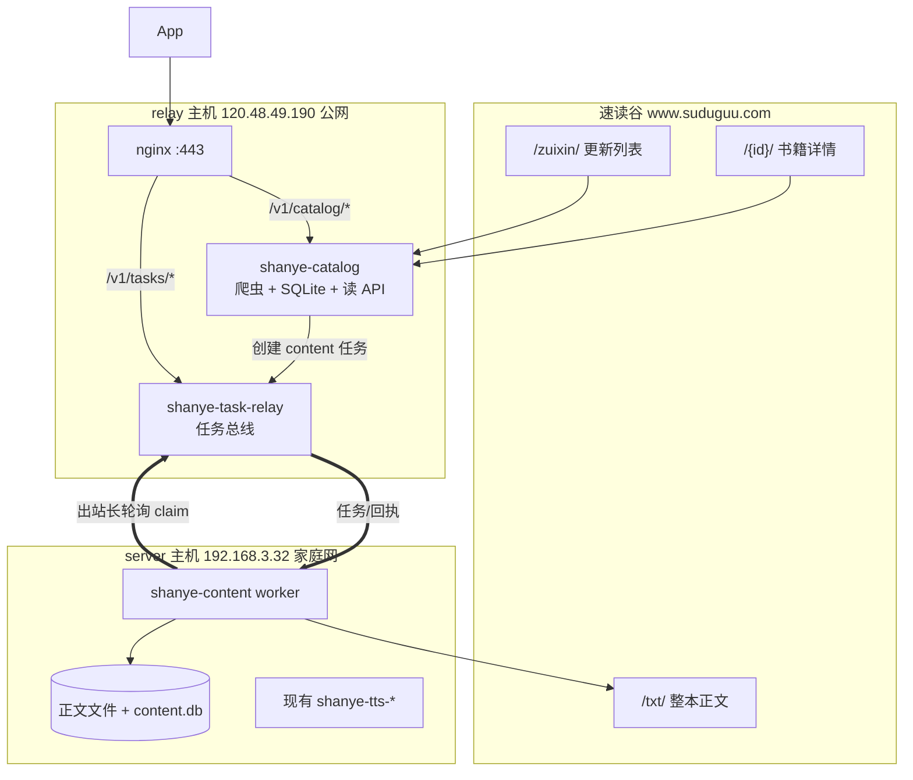

# 速读谷目录与正文服务提案

日期：2026-11-14（v4）。数据划分按最新决定：**元信息全部留在 relay，正文放家庭 server**。

- **relay（公网 120.48.49.190）**：新增 Rust 服务 `shanye-catalog` = 爬虫 + 元数据 SQLite + 只读 API；relay 继续做任务总线；nginx 对外暴露 `/v1/catalog/*`。
- **server（家庭网 192.168.3.32）**：新增 `shanye-content` worker = 领取正文任务、抓取/切片/落盘、按需上传结果；**不存元数据**。
- **App**：只调 relay 的 `/v1/catalog/*`（搜索 / 列表 / 详情）；要正文时由 relay 中转，App 不感知任务细节。

> 已核验：家里能直连站点（`200`，1.1 s），`/txt/` 可下但约 0.9 MB/s；`/h` 余量 122 GB；现有 `shanye-tts-*` 都是 user systemd（`/home/koth/.config/systemd/user/`）。

> **实施进度（2026-11-14 23:15）**：M1、M2 已完成并上线。relay 上 `shanye-catalog.service` 正在跑，库内 **5,426 本、详情字段 100% 落库**；增量定时器（10 分钟）与深扫定时器（每日 04:10）已启用；`https://120.48.49.190/v1/catalog/*` 可查。relay 的 `claim` 已支持 `wait_seconds` 并已部署。代码在 [`catalog/`](../catalog/README.md)，部署见 [`catalog/deploy/`](../catalog/deploy/README.md)。

## 1. 站点实测（2026-11-14 21:40–21:55）

| 项 | 结果 |
| --- | --- |
| 可达性 | 无 Cloudflare；`robots.txt`、`sitemap.xml` 均 404；必须 **HTTP/1.1** |
| 全站书目 | **5,426 本**（`/fenlei/` 17 个分类计数相加） |
| 枚举源 | `/zuixin/` 543 页 × 10 本，末页 6 本 → `542×10+6 = 5,426`，恰好覆盖全站每本一次 |
| 详情页 | `/{bookId}/`：字数、状态、分类、作者、**绝对更新时间**、最新章节；32–73 KB |
| 每日更新 | 第 1–130 页都在 20 小时内、第 150 页已跨天 → **约 1,300–1,500 本/天** |
| 延迟 | relay 侧 1.0–1.6 s/请求；家里 1.1 s |
| 正文 | `/txt/?id={id}&p=1..N`，整本纯文本；653 万字的书 = 2 页（11.2 MB + 6.9 MB）；实测 **2.86 字节/字** |

### 1.1 URL 地图

| 页面 | URL | 用途 |
| --- | --- | --- |
| 分类总览 | `/fenlei/` | 17 分类及书数，交叉校验 |
| 最新更新 | `/zuixin/`、`/zuixin/N.html`（1–543） | **主枚举源 + 增量水位** |
| 详情 | `/{bookId}/` | **元信息落库** |
| 分类列表 | `/dushi/N.html` … | 备用枚举 |
| 整本正文 | `/txt/?id=&p=1..N` | 正文抓取 |

### 1.2 列表页字段

```html
<div class="item"><a href="/7407/"></a><div class="itemtxt">
  <h3><a href="/7407/">九帝塔</a></h3>
  <p><span>连载中</span><span>玄幻小说</span></p>
  <p><a href="/7407/">作者：飞鱼牛牛</a></p>
  <ul><li><i>40分钟前</i><a href="/7407/4874897.html">第332章 …</a></li>…</ul>
</div></div>
```

有 `bookId`、书名、状态、分类、作者、最新章 id/标题、相对时间；**字数和绝对时间只有详情页有**。

### 1.3 详情页字段

```html
<h1><i>653.5万字</i><a href="/51/#dir">捞尸人</a></h1>
<p><span>已完结</span><span>都市小说</span></p>
<p><a href="/zuozhe/?tag=…">作者：纯洁滴小龙</a></p>
<h2 id="dir"><span>更新时间：2026-09-03 06:31:42</span><a href="/51/#dir">全文目录</a></h2>
<div id="list" class="dir clear"><ul><li><a href="/51/3194.html">第一章</a></li>…</ul></div>
```

目录被截断到 **999 条**，不能用来数章节；章节数用「最新章标题里的第 N 章」近似。

### 1.4 更新节奏

| 页 | 首条时间标签 | 判定 |
| --- | --- | --- |
| 1–130 | `40分钟前` … `20小时前` | 20 小时内 |
| 150 | `昨天` | 已跨天 |
| 543（末页） | `09-05`–`09-09` | 全站最旧 |

## 2. 数据划分

| 数据 | 存放 | 体量 | 理由 |
| --- | --- | --- | --- |
| 书籍元信息 | **relay** 本地 SQLite | 5,426 行 ≈ 3 MB | 读多写少；放 relay 让 App 搜索/列表零跨网 |
| 正文 | **server** 本地文件 + 索引表 | 按需，单本 2–8 MB | 体积大；relay 磁盘只做 24h 中转 |
| 任务与结果 | relay（TTL 24 h） | 单本 ZIP 2–8 MB | 现成机制，App 下载中转 |
| 爬虫/同步状态 | relay 的 catalog DB 内 | KB 级 | 与元数据同库，省一个组件 |

关键取舍：**元数据不再走任务**。爬虫就在 relay 本机，直接写 SQLite（WAL 允许一写多读），因此不需要 `catalog.ingest` 之类的任务，也不需要给 relay 加 `inline`/`wait` 扩展。

## 3. 拓扑



- 元数据读写全在 relay 本机，**不经过家庭网**。
- 正文抓取与存储在家里，**只有 KB 级任务与 2–8 MB 结果过网**。

## 4. 元数据（relay）

### 4.1 模型

`/var/lib/shanye-catalog/catalog.sqlite`（WAL）：

```sql
CREATE TABLE books (
  id                INTEGER PRIMARY KEY,   -- 站点 bookId
  title             TEXT NOT NULL,
  author            TEXT NOT NULL,
  category          TEXT NOT NULL,         -- 玄幻小说/都市小说/…
  status            TEXT NOT NULL,         -- 连载中 / 已完结 / 已下架
  words             INTEGER,               -- 换算成「字」
  words_text        TEXT,                  -- 原始「653.5万字」
  chapter_no        INTEGER,               -- 最新章节号，章节数近似
  latest_chapter_id INTEGER,               -- 增量水位
  latest_chapter    TEXT,
  last_update_at    TEXT,                  -- 'YYYY-MM-DD HH:MM:SS'
  cover_url         TEXT,
  meta_level        INTEGER NOT NULL DEFAULT 1,  -- 1=仅列表字段 2=详情已抓
  list_seen_at      INTEGER NOT NULL,
  detail_at         INTEGER,
  detail_failures   INTEGER NOT NULL DEFAULT 0,
  first_seen_at     INTEGER NOT NULL
);
CREATE INDEX books_updated  ON books(last_update_at DESC);
CREATE INDEX books_category ON books(category, last_update_at DESC);
CREATE INDEX books_words    ON books(words DESC);
CREATE INDEX books_pending  ON books(meta_level, id);

CREATE TABLE sync_runs (
  id INTEGER PRIMARY KEY AUTOINCREMENT, kind TEXT NOT NULL,
  started_at INTEGER NOT NULL, finished_at INTEGER,
  pages INTEGER DEFAULT 0, books_seen INTEGER DEFAULT 0,
  books_changed INTEGER DEFAULT 0, detail_ok INTEGER DEFAULT 0,
  detail_failed INTEGER DEFAULT 0, error TEXT
);

CREATE TABLE book_events (                -- 可选：更新历史
  book_id INTEGER NOT NULL, chapter_id INTEGER NOT NULL,
  observed_at INTEGER NOT NULL, PRIMARY KEY (book_id, chapter_id)
);
```

搜索用 `LIKE` 起步（已定：`title LIKE '%q%' OR author LIKE '%q%'`，5,426 行全表扫描 <5 ms；不做分词与拼音，量大了再上 FTS5）。

### 4.2 爬虫

`shanye-catalog` 单进程，tokio 里跑两个角色：HTTP（axum）+ 定时抓取。

- `reqwest` 强制 `http1_only()`；全局限速 2 req/s + 100–400 ms 抖动；UA `shanye-catalog/0.1`。
- 解析 `scraper`，选择器集中在 `parsers.rs`，配 6 份真实 HTML fixture 单测。
- `bootstrap`：扫 `/zuixin/` 1..543 → 5,426 个 id → 逐本抓详情；约 50 分钟、330 MB。
- `incremental`：见 §4.3。
- 失败：单页 3 次退避；302 跳首页视为限流（退避 60 s、降速）；解析 0 条立即中止并留样本。

### 4.3 增量算法

不依赖相对时间，也不假设章节 id 全局单调，只用**每本书自己的最新章 id**：

```text
1) 从 /zuixin/ 第 1 页起扫，收集 (bookId, latestChapterId)，连续 3 页无变化即停（上限 250 页）
2) 与 books.latest_chapter_id 比对 → 差异集合
3) 差异中的书抓详情页（2 req/s）
4) 单事务批量 upsert，写 sync_runs
5) 失败的书保持 meta_level=1，下轮再补
```

| 频率 | 任务 | 规模 | 耗时 |
| --- | --- | --- | --- |
| 每 10 分钟 | 轻量增量（静默 2 页、上限 30 页） | 通常 1–3 页 + 0–50 详情 | < 1 分钟 |
| 每天 04:10 | 深扫（静默 3 页、上限 250 页） | ~150 页 + ~1,300–1,500 详情 | 15–25 分钟 |
| 每周日 04:40 | 全量元信息刷新（直刷详情） | 5,426 详情 | 45–60 分钟 |

边界：新书 → `meta_level=1` 先落列表字段；下架 → 连续 3 次 404 标 `已下架` 不删行；只有完结/字数变更 → 每周全量兜住。

## 5. 正文（server）

### 5.1 存储

```
/h/work/shanye-content/
  content.db        # book_id, chapter_count, chars, sha256, fetched_at, latest_chapter_id
  books/{id}.txt    # 原始纯文本（未切片，便于重新切片）
  packs/{id}.zip    # 按需生成的 App 导入包（含 manifest.json）
```

`/txt/` 的 `p` 从 1 递增，直到返回只有页头（约 165 B）为止；整本落一个 `.txt`。切片按「第N章」正则，切片结果与 App 现有章节结构对齐（标题 + 段落空行）。

### 5.2 任务协议

| kind | 执行方 | payload | 结果 | 去重键 |
| --- | --- | --- | --- | --- |
| `content.fetch` | server worker | `{bookId, latestChapterId}` | 内联 `{chapters, chars, sha256}` | `content.fetch:{bookId}:{latestChapterId}` |
| `content.serve` | server worker | `{bookId, version}` | ZIP 文件（2–8 MB） | `content.serve:{bookId}:{version}` |

- `content.fetch` 由 catalog 在「书进入可下载集合」时创建（首次被 App 请求，或按榜单批量预热）。
- `content.serve` 只在 App 真正要下载时创建；同一版本 24 h 内重复请求命中 dedupe，直接复用结果。
- 家庭上行是关键约束：实测下行约 0.9 MB/s；上行需实测，按 5 Mbps 估，单本 5 MB 上传约 8 s。

### 5.3 worker

Python，复用现有 `server/remote_worker.py` 的轮询骨架（user systemd、`EnvironmentFile`、`Restart=on-failure`）：

```
loop:
  claim(kinds=["content.fetch","content.serve"], wait_seconds=20)   # 无任务时挂起
  content.fetch → 拉 /txt/（流式落盘，超时 180 s）→ 校验页头 → 切片统计 → complete(inline)
  content.serve → 打包 ZIP → 上传结果 → complete(file)
```

`wait_seconds` 由 M1 给 relay 的 `claim` 补上（默认挂起 20 s，无任务返回 204），领取延迟从 5 s 压到 <0.2 s。

## 6. 对外 API（App 只认这一套）

| 方法 | 路径 | 说明 |
| --- | --- | --- |
| GET | `/v1/catalog/search?q=&limit=&cursor=` | **主入口**：按书名/作者搜索 |
| GET | `/v1/catalog/books?category=&status=&sort=updated\|words&limit=&cursor=` | 列表/筛选 |
| GET | `/v1/catalog/books/{id}` | 单本详情 |
| GET | `/v1/catalog/stats` | 总数、分类计数、最近同步 |
| POST | `/v1/catalog/books/{id}/content` | 请求正文：已缓存 → `200 {downloadUrl}`；否则 `202 {taskId}` |
| GET | `/v1/catalog/content/{taskId}` | 轮询状态（内部反代 relay `/v1/tasks/{id}`） |
| GET | `/v1/catalog/content/{taskId}/download` | 流式下载 ZIP（内部反代 relay 结果） |

响应示例：

```json
{
  "items": [{
    "id": 7407, "title": "九帝塔", "author": "飞鱼牛牛",
    "category": "玄幻小说", "status": "连载中",
    "words": 1730000, "chapterNo": 332,
    "lastUpdateAt": "2026-11-14 21:12:03",
    "latestChapter": {"id": 4874897, "title": "第332章 一月金丹，多拉赞助"}
  }],
  "nextCursor": "7407"
}
```

**不做快照**：App 只搜索/查详情，不下载全量目录（按你的决定）。

## 7. 延迟

| 场景 | 链路 | 估计 |
| --- | --- | --- |
| 搜索/列表/详情 | App → nginx → catalog（relay 本机 SQLite） | **20–80 ms** |
| 首次要正文 | 建任务 → worker 领取 → 抓取 → 上传 → 下载 | 抓取 5–20 s + 上传 5–10 s + 下载 2–5 s |
| 二次要正文（24 h 内） | dedupe 命中 relay 已有结果 | 直接下载 |
| 元数据同步 | relay 本机写库 | 不进家庭网，App 无感 |

## 8. 部署

**构建**：relay 只有 1 GB 内存、2 核、未装 cargo，不在它上面编译。沿用现在的做法——在 `emotts`（Linux，cargo 1.96）`cargo build --release`，`scp` 二进制到 relay 后 `systemctl restart shanye-catalog`。Mac 也可编译，但只在本地调试用。

**relay**：新增 systemd 单元 `shanye-catalog.service`（Rust release 二进制），`SHANYE_CATALOG_DB=/var/lib/shanye-catalog/catalog.sqlite`、`SHANYE_CATALOG_BIND=127.0.0.1:17872`；nginx 增加 `location /v1/catalog/ { proxy_pass http://127.0.0.1:17872; }` 与 `/v1/tasks/` 到 relay。

**server**：新增 user 单元 `shanye-content.service`，照抄现有写法：

```ini
[Service]
WorkingDirectory=/h/work/shanye-content
EnvironmentFile=/h/work/shanye-content/content.env   # RELAY_URL/TOKEN/WORKER_ID
ExecStart=/h/work/shanye-tts-service/.api-venv/bin/python -m content.worker
Restart=on-failure
RestartSec=5
```

复用现有 venv（Python 3.11），不加新依赖（`httpx` 已有）。

**运维连接**：`~/.ssh/config` 里已有连接复用条目，所有 ssh/scp/rsync 都复用同一条链路（首连 ~0.9 s，之后 ~0.12 s）：

```sh
ssh relay  ...   # root@120.48.49.190（公网，目录服务与任务中转）
ssh emotts ...   # koth@192.168.3.32（家庭 server，正文与 TTS）
```

## 9. 存储与容量

| 项 | 估算 |
| --- | --- |
| relay 元数据库 | 3 MB（5,426 行）+ 90 天事件历史 ~15 MB |
| relay 结果临时目录 | 单本 2–8 MB，24 h 自动清；并发下载 10 本约 80 MB |
| server 正文 | 平均 250 万字 × 2.86 B ≈ 7 MB/本；全量 5,426 本约 **38 GB**（`/h` 余量 122 GB）；按需抓取，实际增长取决于用户请求 |

## 10. 风险与合规

| 风险 | 应对 |
| --- | --- |
| 站点改版 | 选择器集中在 `parsers.rs`，6 份 fixture 单测；解析 0 条中止并告警 |
| 限流/封 IP | 2 req/s、抖动、夜间全量、302 退避；备用域名 `sudugu520.com` |
| 家庭上行慢 | 只在真正下载时生成 ZIP；`content.serve` 结果 24 h 复用；大书可考虑分卷 |
| 家庭断网 | 任务在 relay 排队，worker 重连自动领走；App 侧读超时回落 |
| 版权 | 元信息是事实数据；正文按用户请求抓取、只作本机离线阅读，不再分发 |

## 11. 里程碑

| 阶段 | 内容 | 估时 | 状态 |
| --- | --- | --- | --- |
| M1 | `shanye-catalog`：解析器 + bootstrap + SQLite；relay `claim` 支持 `wait_seconds` | 1 天 | ✅ 完成：5,426 本、0 失败；relay 18 个测试通过，`wait_seconds` 已上线 |
| M2 | catalog 读 API + nginx + 增量调度 | 1 天 | ✅ 完成：`/v1/catalog/*` 已公网可查；10 分钟增量实测 9.4 s 更新 14 本；每日深扫 04:10 |
| M3 | App 接入搜索/详情 | 0.5 天 | 待做 |
| M4 | `shanye-content` worker + 正文 API | 1 天 | 待做 |
| M5 | 热门 200 本正文预热（`/paihang/` 榜） | 0.5 天 | 待做 |

最小可用：M1–M3（约 2.5 天），App 能搜到全站书；M4 再加正文下载，M5 把热门书提前备好。

## 12. 已定与剩余

**已定**（2026-11-14）：

1. 搜索先用简单 `LIKE`（书名/作者子串 + 分类/状态过滤），不引入分词或拼音索引。
2. 先爬完全部元数据，再抓**热门 200 本**正文（取自 `/paihang/` 榜）。
3. relay 的 `claim` **加 `wait_seconds`**（默认 20 s），正文任务领取延迟从 5 s 降到 <0.2 s。

**剩余**：

1. 部署方式：按现有习惯在 `emotts`（Linux，cargo 1.96）编译、`scp` 到 relay 换二进制，还是直接在 relay 上装 toolchain？（relay 只有 1 GB 内存、2 核、无 cargo，倾向走 emotts 构建）
2. App 里「搜索」入口放在书房还是新增一级页签？
