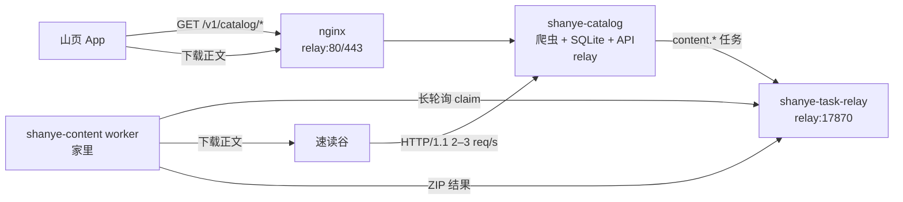

# 山页 · 速读谷目录服务交接文档

日期：2026-11-15 · 状态：M1–M5 已实现并部署（实现记录见 [catalog-implementation-20261115.md](catalog-implementation-20261115.md)）
读者：接手继续开发的同学（或下一个 agent）。设计背景见 [catalog-crawl-proposal.md](catalog-crawl-proposal.md)。

**部署更新（2026-11-15）**：家庭后端已全部迁移至 `jetson@192.168.3.33`，两个正文 worker 和 200 本缓存也已迁入，旧 `emotts` 已关机。公网目录和 Rust 中转继续运行。下文 x86 构建与旧部署命令保留作历史背景，当前路径、启动方式和验收见 [后端迁移记录](../reviews/jetson-server-migration-20261115/README.md)。

---

## 1. 三十秒概览

速读谷（www.suduguu.com）的全部书籍元信息已经爬到 relay 上，5,426 本、字段齐全，并且对外提供了搜索接口。

```bash
# 一条命令验证服务活着
curl -s "http://120.48.49.190/v1/catalog/stats" | head -c 120
# {"books":5426,"detail_complete":5426,...

# 一条命令验证搜索
curl -s "http://120.48.49.190/v1/catalog/search?q=九帝&limit=2"
```

本交接文档中的三件事已经完成：**App 接搜索（M3）→ 家里抓正文（M4）→ 热门 200 本预热（M5）**。

---

## 2. 现状清单

| 组件 | 主机 | 地址 | 单元 / 路径 | 状态 |
| --- | --- | --- | --- | --- |
| 元数据爬虫 + 目录 API | relay `120.48.49.190` | 127.0.0.1:17872 | `shanye-catalog.service`，`/usr/local/bin/shanye-catalog` | ✅ active |
| 目录数据库 | relay | — | `/var/lib/shanye-catalog/catalog.sqlite`（1.97 MB） | ✅ 5,426 本 |
| 10 分钟增量 | relay | — | `shanye-catalog-incremental.{service,timer}` | ✅ 启用 |
| 每日深扫 | relay | — | `shanye-catalog-deep.{service,timer}`，04:10 | ✅ 启用 |
| 对外入口 | relay | 80 / 443 | nginx `location /v1/catalog/` → 17872 | ✅ 两个端口都通 |
| 任务总线 | relay | 17870 | `shanye-task-relay.service`，`/opt/shanye-task-relay/` | ✅ active（已升到含 `wait_seconds` 版本） |
| TTS + 现有 worker | 家里 `192.168.3.32` | 17860/17871 | `shanye-tts-*` 四个 user unit | ✅ 未改动 |
| 正文存储 | 家里 | — | `/h/work/shanye-content/` | ⬜ 待建（M4） |

**主机画像**

- relay：Ubuntu 24.04，2 核 / **1 GB 内存** / 25 GB 可用。**不要在这上面编译**。
- 家里：Ubuntu 20.04（`yvonchen-LC0`），GPU 机，`/h` 剩 122 GB，Python venv 在 `/h/work/shanye-tts-service/.api-venv`（3.11）。
- 构建机：家里（`ssh emotts`），cargo 1.96。

**SSH 复用**（`~/.ssh/config` 已配 `ControlMaster` + `ControlPersist 8h`）：

```bash
ssh relay     # root@120.48.49.190
ssh emotts    # koth@192.168.3.32
```
首连约 0.3–0.9 s，之后 0.12–0.14 s；rsync/scp 自动复用同一条链路。

---

## 3. 架构与数据划分



| 数据 | 放哪 | 原因 |
| --- | --- | --- |
| 书籍元信息 | relay 本地 SQLite | 读多写少，App 搜索**不跨家庭网** |
| 正文 | 家里 `/h/work/shanye-content/` | 体积大（全量约 38 GB），家里盘富余 |
| 任务与结果 | relay（结果 24 h TTL） | 现成机制，App 下载中转 |
| 同步水位 | 与元数据同库（`latest_chapter_id`） | 少一个组件 |

> 关键决定：**元数据不走任务**。爬虫和库在同一台机器，直接写 SQLite 即可；只有正文才用 relay 的任务机制。

---

## 4. 代码位置

```
catalog/                       # 新增：Rust 目录服务（958 行）
  Cargo.toml
  src/main.rs                  # CLI + 抓取循环 + 限速器（bootstrap/incremental/serve/stats）
  src/parsers.rs               # 唯一改选择器的地方；含 5 个单测
  src/db.rs                    # schema、upsert、搜索/列表/详情查询
  src/api.rs                   # axum 路由
  fixtures/                    # 真实页面快照（列表页 / 详情页 ×2）
  deploy/                      # systemd 单元、env 样例、部署步骤
  README.md

relay/                         # 已有，本轮改动很小
  src/main.rs                  # ClaimRequest 新增 wait_seconds；claim_task 变成长轮询；
                               # 抽出 try_claim()，不跨 await 持锁
  src/tests.rs                 # 新增 2 个测试（有任务立即返回 / 空队列挂起）

docs/catalog-crawl-proposal.md # 设计与实测数据（v4）
```

质量门：

```bash
cargo test --manifest-path catalog/Cargo.toml   # 5 passed
cargo test --manifest-path relay/Cargo.toml     # 18 passed
```

---

## 5. 运维手册

### 5.1 构建与发布

**catalog（relay 侧服务）**

```bash
# 本机 → 构建机
rsync -az --exclude target --exclude '*.sqlite*' catalog/ emotts:/h/work/shanye-catalog/
ssh emotts 'cd /h/work/shanye-catalog && cargo build --release'
# 构建机 → relay
rsync -az emotts:/h/work/shanye-catalog/target/release/shanye-catalog /tmp/
scp /tmp/shanye-catalog relay:/usr/local/bin/shanye-catalog
ssh relay 'chmod 755 /usr/local/bin/shanye-catalog && systemctl restart shanye-catalog'
```

**relay 本体**

```bash
rsync -az --exclude target relay/ emotts:/h/work/shanye-task-relay-build-20261114/
ssh emotts 'cd /h/work/shanye-task-relay-build-20261114 && cargo build --release'
rsync -az emotts:/h/work/shanye-task-relay-build-20261114/target/release/shanye-task-relay /tmp/
ssh relay 'systemctl stop shanye-task-relay && cp /opt/shanye-task-relay/shanye-task-relay \
  /opt/shanye-task-relay/shanye-task-relay.bak-$(date +%Y%m%d)'
scp /tmp/shanye-task-relay relay:/opt/shanye-task-relay/shanye-task-relay
ssh relay 'chown shanye-relay:shanye-relay /opt/shanye-task-relay/shanye-task-relay &&
  systemctl start shanye-task-relay'
```

### 5.2 日常检查

```bash
ssh relay 'systemctl is-active shanye-catalog shanye-task-relay;
           systemctl list-timers --no-pager | grep catalog;
           journalctl -u shanye-catalog -n 20 -o cat'

# 库统计（relay 上直接跑，不用起服务）
ssh relay 'SHANYE_CATALOG_DB=/var/lib/shanye-catalog/catalog.sqlite \
           /usr/local/bin/shanye-catalog stats'
```

### 5.3 手动跑一次同步

```bash
ssh relay 'systemctl start shanye-catalog-incremental.service'   # 10 分钟档，通常 10–30 s
ssh relay 'systemctl start shanye-catalog-deep.service'          # 24 h 深扫，15–25 分钟
```

### 5.4 备份 / 恢复

```bash
ssh relay 'sqlite3 /var/lib/shanye-catalog/catalog.sqlite ".backup /tmp/catalog-$(date +%F).sqlite"'
scp relay:/tmp/catalog-$(date +%F).sqlite ./backup/
# 恢复：停服务 → 覆盖文件 → 起服务（顺带删掉 -wal/-shm）
```

全量重建也就 25 分钟：`ssh relay 'SHANYE_CATALOG_DB=/var/lib/shanye-catalog/catalog.sqlite /usr/local/bin/shanye-catalog bootstrap --pages 600'`（先停 `shanye-catalog` 再跑，避免并发写）。

---

## 6. 接口

Base URL：`http://120.48.49.190`（明文，App 原型用）或 `https://120.48.49.190`（自签证书，需 `-k`）。
**当前无鉴权**（内网原型阶段），公网暴露后建议加 `X-Relay-Token`。

| 方法 | 路径 | 参数 | 说明 |
| --- | --- | --- | --- |
| GET | `/healthz` | — | 存活 |
| GET | `/v1/catalog/stats` | — | 总数、分类分布、最近同步 |
| GET | `/v1/catalog/search` | `q`, `limit`(1–200), `cursor` | 书名/作者 LIKE |
| GET | `/v1/catalog/books` | `category`, `status`, `sort=updated\|words`, `limit`, `cursor` | 列表 |
| GET | `/v1/catalog/books/{id}` | — | 单本 |

示例：

```bash
curl -s "http://120.48.49.190/v1/catalog/search?q=%E4%B9%9D%E5%B8%9D&limit=3"
```
```json
{"items":[{"id":7407,"title":"九帝塔","author":"飞鱼牛牛","category":"玄幻小说",
  "status":"连载中","words":687000,"chapter_no":332,
  "last_update_at":"2026-11-14 21:04:43",
  "latest_chapter":"第332章 一月金丹，多拉赞助","latest_chapter_id":4874897}],
 "nextCursor":7407}
```

`cursor` 语义：搜索按 `id > cursor` 翻页；列表按 `id < cursor` 翻页（列表是倒序）。返回值里的 `nextCursor` 直接回传即可。

---

## 7. 数据模型

`books`（5,426 行）：

| 字段 | 含义 |
| --- | --- |
| `id` | 站点 bookId（URL 里的数字） |
| `title/author/category/status` | 书名、作者、分类（不统一，如「现代言情」「诸天无限」）、`连载中`/`已完结` |
| `words` / `words_text` | 字数（换算成字）/ 原始「653.5万字」 |
| `chapter_no` | 最新章节号（从标题解析，中文章号也能解；**若最新章是「完本感言」「番外」这类无章号标题则为 0**，例如 51 号捞尸人） |
| `latest_chapter_id` / `latest_chapter` | 最新章 id 与标题，**增量水位** |
| `last_update_at` | 详情页绝对时间 `YYYY-MM-DD HH:MM:SS` |
| `meta_level` | 1=只有列表字段，2=详情已抓（当前全部为 2） |
| `detail_failures` | 详情抓取失败次数，重试排序用 |

`sync_runs`：每次 bootstrap/incremental 的 pages/seen/changed/ok/failed。

---

## 8. 已验证的事实（别重复踩）

1. **必须 HTTP/1.1**：`reqwest` 已 `http1_only()`；本地 curl 走 HTTP/2 会 framing error。
2. 站点**没有** `robots.txt` / `sitemap.xml`；枚举源就是 `/zuixin/` 543 页 × 10 本 = 5,426（末页 6 本，`542×10+6`）。
3. 详情页目录**截断 999 条**，不能用来数章节；章节数用最新章标题里的「第 N 章」。
4. 分类名不统一（「××小说」/「现代言情」/「诸天无限」），坑过一次：曾导致 547 本分类为空，现已修（`div.itemtxt p span` 取第二个）。
5. 列表页只有相对时间（「40分钟前」「昨天」「09-03」），**不能当水位**；用每本书自己的 `latest_chapter_id` 比对。
6. 限速：relay 上 2–3 req/s 稳定；>3 req/s 开始出现 302/变慢。解析到 0 条要立刻中止并留样本。
7. 家里能直连站点（200 / 1.1 s），但 `/txt/` 下载只有约 0.9 MB/s（653 万字的书 18 MB，约 20 s）。
8. relay 只有 1 GB 内存、未装 cargo。下方旧部署命令中的 `emotts` 是 x86_64 构建机；它不再作为常开后端。Jetson 是 ARM64，不能把其本机编译的二进制直接部署到 x86_64 公网机；更新公网 Rust 程序时需使用匹配目标架构的构建环境。

---

## 9. 接下来要做的

### M3 · App 接入搜索（0.5 天）

**目标**：App 里能搜到全站书，点进去看到元信息（书名/作者/分类/字数/更新/最新章节）。

**现状**：`app/` 是 Compose 原型，`HomeScreen.kt` 的搜索只查本地 SQLite 书库；`AndroidManifest` 已有 `INTERNET` + `usesCleartextTraffic=true`。

**改动点**

1. 新增 `data/CatalogClient.kt`：`HttpURLConnection` 或 OkHttp（项目目前没引网络库，建议先用 `HttpURLConnection` 少一个依赖），两个方法：
   - `search(q: String, limit: Int = 20): List<CatalogBook>`
   - `book(id: Long): CatalogBook`
   Base URL 放 `BuildConfig` 或常量（`http://120.48.49.190`）。
2. 数据类 `CatalogBook(id, title, author, category, status, words, chapterNo, lastUpdate, latestChapter)`，用 `org.json` 解析即可。
3. UI：书架页搜索框增加「全网」分区，或书房新增「发现」入口；结果项展示「书名 · 作者 · 分类 · 字数 · 更新时间」，点击进详情页（先只读展示元信息）。
4. 网络在 `Dispatchers.IO`，加 loading/空态/错误态；搜索输入 300 ms 防抖。
5. 缓存：最近一次搜索结果内存缓存即可，暂不落库。

**验收**：飞行模式下搜索给出明确错误提示；正常网络搜「九帝」1 s 内出结果；点击能显示字数与最后更新时间。

**坑**：HTTPS 是自签证书，App 直接连会 TLS 失败——**用 80 端口的明文地址**（已验证可用），或后续换成正式域名证书。

### M4 · 家里抓正文 + 正文 API（1 天）

**目标**：App 请求某本书的正文 → relay 建任务 → 家里 worker 抓取切片落盘 → 上传 ZIP → App 下载；重复请求 24 h 内直接命中。

**协议**（详见 proposal §5）

| kind | 执行方 | payload | 结果 | 去重键 |
| --- | --- | --- | --- | --- |
| `content.fetch` | 家里 worker | `{bookId, latestChapterId}` | 内联 JSON `{chapters, chars, sha256}` | `content.fetch:{bookId}:{latestChapterId}` |
| `content.serve` | 家里 worker | `{bookId, version}` | ZIP 文件（2–8 MB） | `content.serve:{bookId}:{version}` |

**家里侧改动**

1. 新建 `/h/work/shanye-content/`：`content.db`（book_id, chapters, chars, sha256, fetched_at, latest_chapter_id）、`books/{id}.txt`、`packs/{id}.zip`。
2. `content/worker.py`：照抄 `server/remote_worker.py` 的轮询骨架，`claim` 时带 `wait_seconds: 20`（relay 已支持）；`content.fetch` 流式下载 `/txt/?id={id}&p=1..N` 直到只返回页头（约 165 B），按「第N章」切片；`content.serve` 打包 ZIP（含 `manifest.json`）。
3. user systemd 单元 `shanye-content.service`：

```ini
[Service]
WorkingDirectory=/h/work/shanye-content
EnvironmentFile=/h/work/shanye-content/content.env
ExecStart=/h/work/shanye-tts-service/.api-venv/bin/python -m content.worker
Restart=on-failure
RestartSec=5
```

`content.env` 需要：`SHANYE_RELAY_URL=http://120.48.49.190:17870`、`SHANYE_RELAY_TOKEN=`（从 `/h/work/shanye-tts-service/service.env` 取同一个）、`SHANYE_RELAY_WORKER_ID=content-yvonchen-LC0`。

**relay 侧**

catalog 增加三个路由（转发到 relay 任务 API）：
- `POST /v1/catalog/books/{id}/content` → 已缓存返 `200 {downloadUrl}`，否则建任务返 `202 {taskId}`
- `GET /v1/catalog/content/{taskId}` → 反代 relay `/v1/tasks/{id}/status`
- `GET /v1/catalog/content/{taskId}/download` → 反代 relay 结果流

**验收**：`curl -X POST .../books/51/content` → 轮询到 completed → 下载 ZIP 能解开且章节数与 `chapter_no` 接近；同一本书 1 分钟内再请求直接拿到同一结果。

**坑**：家里上行是关键（单本 5 MB 约 8 s）；`/txt/` 请求要长超时（≥180 s）；结果文件默认 24 h 过期，过期后重复请求会重新建任务（dedupe_key 相同但旧结果已清）。

### M5 · 热门 200 本预热（0.5 天）

**目标**：`/paihang/` 榜前 200 本正文提前备好，App 点击即下载。

**做法**：relay 侧加一个 `preheat` 子命令（或 cron 单元）：解析 `/paihang/`（首页那张榜，无需登录），取前 200 个 bookId → 对每本 `POST /v1/tasks` 建 `content.fetch` 任务（`priority=10`，`dedupe_key` 按章号）→ 家里 worker 自然消费。

**验收**：任务全部 completed；榜内随机点 3 本，App 秒开。

**坑**：一次建 200 个任务要限速建（每秒 ≤2），别把 relay 打满；先确认家里磁盘（200 × 7 MB ≈ 1.4 GB，够）。

---

## 10. 待决策 / 风险

| 项 | 说明 | 建议 |
| --- | --- | --- |
| 正式 TLS | 现在是自签证书，App 只能走 80 明文 | 有域名后上 Let's Encrypt，App 切 https |
| 接口鉴权 | `/v1/catalog/*` 目前完全公开 | 加 `X-Relay-Token`；或 nginx 层限流 |
| 正文版权 | 站点是聚合站，正文非授权 | 只做用户按需抓取 + 本机缓存，不做批量分发 |
| 家庭上行 | 单本 ZIP 2–8 MB 走家宽上传 | 已用 24 h 结果缓存；后续可加「同书多端共享」 |
| 搜索质量 | 目前纯 `LIKE` 子串 | 够用；要拼音/分词再上 FTS5 |
| relay 单点 | 只有 1 台，挂了就没有目录 | 元数据库 2 MB，定期 `sqlite3 .backup` 到家里 |

---

## 11. 一页速查

```bash
# 服务健康
ssh relay 'systemctl is-active shanye-catalog shanye-task-relay'
curl -s http://120.48.49.190/v1/catalog/stats | head -c 100

# 同步状态
ssh relay 'journalctl -u shanye-catalog -n 30 -o cat'
ssh relay 'SHANYE_CATALOG_DB=/var/lib/shanye-catalog/catalog.sqlite /usr/local/bin/shanye-catalog stats'

# 跑一次同步 / 全量重建
ssh relay 'systemctl start shanye-catalog-incremental.service'
ssh relay 'systemctl stop shanye-catalog && SHANYE_CATALOG_DB=/var/lib/shanye-catalog/catalog.sqlite \
  /usr/local/bin/shanye-catalog bootstrap --pages 600 && systemctl start shanye-catalog'

# 测试
cargo test --manifest-path catalog/Cargo.toml
cargo test --manifest-path relay/Cargo.toml

# 搜索 / 列表 / 详情
curl -s "http://120.48.49.190/v1/catalog/search?q=捞尸&limit=5"
curl -s "http://120.48.49.190/v1/catalog/books?category=玄幻小说&sort=words&limit=5"
curl -s "http://120.48.49.190/v1/catalog/books/51"
```
