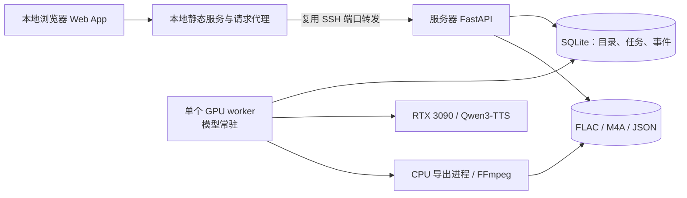

# 山页语音合成工作台提案

日期：2026-11-11。范围：服务器提供合成服务，本地浏览器选择小说、章节、音色与语速，试听、提交任务并下载结果。

> 本方案已整理为 [OpenSpec 变更：add-tts-synthesis-workbench](../openspec/changes/add-tts-synthesis-workbench/proposal.md)，后续以其 design、specs 和 tasks 为实施依据。服务器内容已在同日按要求清理，模型与环境保留；下文“已有音频库”“接续任务”等为清理前假设。当前已实施，最新架构以本地只读书库为入口，服务器仅接收选中章节并合成；短参考音频克隆使用 Qwen3-TTS Base。操作方式见 [服务文档](../server/README.md)。下文保留最初方案背景，冲突时以 OpenSpec 更新后的 design/specs 为准。

## 1. 建议方案

采用 **本地 React Web App + 本地连接代理 + 服务器 FastAPI + 持久任务队列 + 单个常驻 GPU worker**。

第一版沿用当前 RTX 3090、Qwen3-TTS 1.7B CustomVoice 和已有音频库。默认预设固定为用户确认的 **Dylan、明亮沉稳、中性语气、1.0 倍速**。先把现有合成流程变成可操作、可恢复的服务，再扩展声音克隆和其他模型。

最常用的操作应是：

> 选《噩夢使徒》 → 输入 `914-919` → 选旁白预设 → 试听 → 合成缺失内容 → 网页播放或一键下载。

如果这些章节已经按相同声音生成，直接返回已有结果，无需再次排队合成。

## 2. 本地 Web App

主工作区采用三栏：左侧书籍与章节，中间文字和音频，右侧声音设置；底部显示任务队列。

```text
山页 · 语音工作台                         服务器已连接 · GPU 正在工作
┌────────────────┬────────────────────────┬──────────────────────┐
│ 《噩夢使徒》    │ 第 914 章 老拐          │ 旁白预设             │
│ 搜索章号/标题   │                        │ 明亮沉稳 · Dylan     │
│ 选择：914-919   │ 原文与逐句定位          │                      │
│                │                        │ 语气：中性平稳        │
│ ☑ 914 已完成   │                        │ 成品语速：1.0×       │
│ ☑ 915 已完成   │                        │ 句间停顿：180ms      │
│ ☑ 916 已完成   │                        │                      │
│ …              │ ▶ ━━━━━━━ 04:12/40:33 │ [试听] [合成缺失内容]│
│                │ [下载本章] [下载所选]   │ [保存为预设]         │
├────────────────┴────────────────────────┴──────────────────────┤
│ 任务：912–1281 章   进度 / 当前章节 / 失败片段 / [暂停] [重试]   │
└────────────────────────────────────────────────────────────────┘
```

上图仅为布局示意，进度和状态以服务端实际记录为准。

| 功能 | 首版行为 |
| --- | --- |
| 选择内容 | 选择服务器已有书籍；支持单章、连续范围、离散章号，如 `914,916-919`，也可勾选目录。提交前显示标题、字数、片段数。 |
| 选择音色 | 从模型实际支持的音色中选择，展示性别、语言及试听；默认置顶 Dylan。其他音色不会被标成“已试听确认”。 |
| 调节语气 | 提供“中性平稳”“温和叙述”等预设，以及可编辑的自然语言描述。名称和完整指令一起保存。 |
| 调节语速 | 默认 1.0，首版提供 0.75–1.5 倍的成品导出速度；播放器倍速是独立选项。 |
| 先试听 | 从选中章节开头取若干完整片段，目标约 30–60 秒；按真实结果显示时长，不把句子强行截断。试听优先排队。 |
| 批量合成 | 默认“复用已有，只生成缺失”；另外提供“新建版本重新生成”，用于更换音色、语气或修复质量。 |
| 管理任务 | 展示排队、运行、暂停、失败、已完成；可暂停、继续、取消、只重试失败项。刷新网页后恢复状态。 |
| 试听与校对 | 播放章节、拖动进度、逐句高亮；点句子定位播放，标记需要重做的片段。 |
| 保存本地 | 单章下载 M4A；批量生成 ZIP，包含 M4A、JSON 时间索引及目录清单。浏览器正常下载到用户选择的位置。 |

Qwen CustomVoice 当前提供固定音色并支持指令控制；VoiceDesign 和声音克隆需要对应的其他模型，不能把输入风格描述当作任意创建全新音色。首版优先使用现有 CustomVoice 能力。[Qwen 官方文档](https://github.com/QwenLM/Qwen3-TTS)

“中性”“沉稳”等风格是模型指令，实际效果以试听为准。第一版不做角色自动分配、多人对白或逐字时间戳。

## 3. 服务架构与技术栈



| 部分 | 选择 | 理由 |
| --- | --- | --- |
| Web 界面 | React + TypeScript + Vite | 适合目录、参数表单、任务状态和播放器；开发与构建使用一套前端。 |
| 本地启动器 | 轻量 Python 进程 | 提供构建后的页面、同源代理，并维护 SSH 隧道；用户一条命令启动。 |
| 服务 API | FastAPI + Pydantic + Uvicorn | 与现有 Python 合成代码整合；负责参数校验、任务、进度和文件访问。 |
| GPU worker | 当前 PyTorch/CUDA + Qwen3-TTS | 使用已有权重和环境，加载一次后连续处理任务。 |
| 队列与目录 | SQLite，服务器本地文件系统 | 当前是一台服务器、一张显卡，数据库事务足以实现持久队列。 |
| 音频导出 | FFmpeg + SoundFile | 保留现有 FLAC 片段、M4A 和 UTF-16 时间索引。 |
| 状态更新 | 首版每 2 秒查询状态，页面后台时降低频率 | 实现简单，重连后能直接读取完整状态；需要时再加 SSE。 |
| 进程维护 | systemd 用户服务，API 与 worker 分开 | API 重启不重载模型；worker 崩溃后可恢复未完成任务。部署时确认用户服务和 linger 能力。 |

GPU 工作放在独立 worker 中。API 进程不导入或加载模型，Web 请求只提交任务并立即返回任务 ID；首版不引入 Redis/Celery，后续多 GPU 时再替换队列实现。FastAPI 官方也将重计算与普通请求后的轻量后台任务作了区分。[FastAPI 后台任务文档](https://fastapi.tiangolo.com/tutorial/background-tasks/)

前端选型参考：[React](https://react.dev/learn)、[Vite](https://vite.dev/guide/)。具体依赖版本在实施时锁定。

### 本地如何连接服务器

服务器 API 监听 `127.0.0.1:17860`。本地启动器建立一条长期 SSH 隧道，示意命令如下：

```sh
ssh -N -T -o ExitOnForwardFailure=yes \
  -o ServerAliveInterval=30 -o ServerAliveCountMax=3 \
  -L 127.0.0.1:17860:127.0.0.1:17860 koth@192.168.3.32
```

本地页面和 `/api`、`/media` 都通过本地代理访问，复用这一条连接。SSH 断开时显示“正在重连”，启动器退避重连；已提交的服务器任务继续执行，连接恢复后重新读取状态。SSH 密钥和远端访问凭据由本地进程持有，浏览器不接触密钥。

本地代理只监听 loopback，校验 Host/Origin；写请求使用同源会话校验。初期沿用现有 SSH 登录权限，不需要对公网暴露端口。以后需要 Android 直接访问时，再提供局域网 HTTPS 或正式账号入口。

## 4. 任务如何调度与恢复

### 一张显卡只由一个 worker 调度

worker 常驻模型，统一调度批量合成和试听，避免同时启动多个模型进程争抢显存。CPU 导出单独排队，首版限制一个导出进程；GPU 可以在上一章编码时继续下一章。

任务分成三层：用户任务 → 章节 → 语音片段。长篇任务每个批次完成后保存进度并检查控制指令。试听在当前批次结束后插入执行，再恢复长篇任务；多个试听按先进先出处理，限制连续插队数量，避免批量任务长期饿死。

暂停与取消均等当前批次落盘后生效。暂停保留位置以便继续；取消停止后续调度，已生成片段留作缓存。正在运行的任务配置不可原地修改；更改声音或语气创建新版本。

### 持久队列

任务主状态：

```text
queued → running → exporting → succeeded
            ↓          ↓
         pausing     partial_failed
            ↓
          paused → queued

queued / running → cancelling → cancelled
```

调度时用短事务领取任务，记录 `worker_id`、租约、心跳和当前片段。计算与文件编码在事务之外执行。worker 重启后，过期租约回到队列；查询实际已提交片段和文件校验结果，继续缺失内容。任务提交采用幂等键，重复点击和网络重试不会创建多份相同任务；片段结果本身也做去重。

### 失败以片段为单位处理

本次检查发现：当前任务第 1151 章有一个片段生成了 122.8 秒音频，触发现有 120 秒校验上限；当前脚本将同批 8 段一起记为失败。因此首版需要：

- 每段独立校验与提交，单段异常不丢弃同批其他有效结果。
- 短暂错误有限重试；可恢复的 OOM 缩小批次。
- 对异常长音频、静音、非有限值单独处理：先重试，持续异常时拆短语音单元，继续保留父句和原文范围；不能仅放宽上限接受可疑音频。
- 重试耗尽后明确展示章节、原文与错误；完整章节发布前检查是否缺段。
- ASR 作为可选复核，不把所有人名同音差异自动判成合成错误。

若仍有失败片段，任务标为 `partial_failed`，不显示“全部完成”。进度同时显示章节数和片段数，当前阶段区分排队、模型加载、合成、编码与校验。

## 5. 数据、缓存与版本

### 接续现有小说和音频

复用已有 `chapters`、`segments`、`profiles`、`audio` 的信息以及 M4A/JSON。新增的服务层通过迁移导入统一目录，保留旧 profile 与路径映射。

章节选择必须解析成 `chapter_id`，不能只凭章号作为主键：当前第 912 章的 `chapter_index` 为 910，且源书有两个内容不同的第 1169 章。Web 同时显示章号、标题、同号顺序；区间选择默认包含区间内所有源章节，单章遇到同号时展开条目确认选择。

新文件按 `book_id/variant_id/chapter_id/export_id` 组织，下载时再转换成人可读的“0914 老拐.m4a”；这样多本书、同号章节和多版本不会覆盖彼此。

### 两种复用分开处理

**语音片段缓存**依据：原文版本、实际朗读文本、分句/规范化版本、引擎与模型 revision、音色、完整风格指令和生成参数。每次实际生成还记录 seed、批次、运行库和尝试次数；批次变化可能影响随机生成，不承诺逐字节重现。

**章节导出缓存**依据：有序片段 ID 与音频哈希、成品语速、句间停顿、编码格式。

只把 1.0 改成 1.15 时，复用原始 FLAC，由 CPU 重新导出并重算时间索引；无需 GPU 重新发声。浏览器播放器倍速只影响本次播放，不新建导出。现有脚本把导出速度写进 profile 哈希，服务化时要拆开这两个概念，并为历史 profile 建映射。

“强制重合成”创建新的生成版本并保存旧结果，不覆盖正在播放或已下载的版本。默认“合成缺失”复用已完成片段。试听覆盖的片段在配置一致时也可以用于整章任务。

### 保持与阅读器对应

继续保留 `original_text`、`spoken_text`、父句和片段的 UTF-16 范围，以及实际 PCM 导出后的毫秒时间点。简繁切换只作用于显示，既有原文哈希和定位不变。未来加入人名读音词典时只改变朗读输入并更新缓存版本，不修改原文。

文件先写临时位置，计算哈希并原子替换后，再把数据库记录标为就绪；章节导出由一份确定的片段清单驱动，M4A 与 JSON 都完成校验后才发布。重做某句后生成新的章节导出版本，避免旧 JSON 对应新音频。

### 建议增加的表

| 表 | 主要职责 |
| --- | --- |
| `voice_presets` / `voice_preset_versions` | 可读名称、speaker、风格指令及不可变版本。 |
| `jobs` / `job_items` | 用户任务、章节与片段范围、优先级、状态、租约、重试策略。 |
| `job_events` | 可恢复查询的进度与错误事件；每批聚合记录，避免逐 token 写库。 |
| `synthesis_variants` / `segment_audio` | 生成配置与实际音频结果；可映射历史 profile。 |
| `chapter_exports` / `artifacts` | 导出配置、文件位置、哈希、完整性和依赖的片段版本。 |
| `reading_profiles` | 某本书某个章号范围使用哪个已确认版本，承接现有 `reading-plan.json`。 |

SQLite 保存定位和文件引用，音频继续作为独立文件存放。

## 6. 存储、播放与下载

本次只读检查确认：服务器 `/h` 挂载类型为 `fuseblk`，剩余空间约 111GB；系统分区剩余约 13GB。建议模型、音频与大临时文件继续在 `/h/work`，服务元数据和任务库放到服务器本机 Linux 文件系统，例如 `/home/koth/.local/share/shanye-tts/`。数据库要验证锁、事务、断电恢复与备份，避免把任务库放到本地电脑的共享挂载上。SQLite WAL 要求访问数据库的进程位于同一主机。[SQLite WAL 文档](https://www.sqlite.org/wal.html)

元数据目录做容量监控；数据库使用短事务、busy timeout 和定期 checkpoint。已有运行中的数据库用 SQLite backup API 创建一致快照后导入，不直接复制仍在写入的 `.sqlite` 文件。

音频播放使用带鉴权的文件 API，支持 HTTP Range；浏览器可以边取文件边播放和拖动，无需先下载完整章节。该能力可以使用 Starlette 的文件响应，但本地代理也必须透传 Range、206、Content-Range 和缓存头。[Starlette 文件响应文档](https://starlette.dev/responses/)

API 接受受控的 `artifact_id`，不允许客户端传任意服务器文件路径。批量 ZIP 在 CPU 队列生成，完成后下载，不把全部文件读进内存。缓存音频可复用，ZIP 临时包按到期时间清理。网页下载完成与“文件已由浏览器请求”要区分，浏览器通常不能保证用户最终保存位置；保存到指定目录的自动同步可作为下一阶段本地启动器功能。

磁盘使用持续展示；首版沿用剩余不足 5GiB 暂停新生成的底线，并按近期字数/音频/字节比预估批量任务空间。已经确认的小说音频不自动清理；临时包、失败临时文件和试听缓存可按明确规则回收。

## 7. API 草案

| API | 用途 |
| --- | --- |
| `GET /api/v1/health` | API、worker、模型、GPU、磁盘、连接状态。 |
| `GET /api/v1/books` | 已导入书籍。 |
| `GET /api/v1/books/{id}/chapters` | 分页目录、搜索、指定预设下的生成/导出状态。 |
| `POST /api/v1/chapter-selections/resolve` | 将区间或章号列表解析为稳定的章节 ID，展示同号章节。 |
| `GET /api/v1/voices`、`GET/POST /api/v1/presets` | 音色能力、用户旁白预设与版本。 |
| `POST /api/v1/previews` | 提交高优先级试听任务，返回 job ID。 |
| `POST /api/v1/jobs/estimate` | 返回缺失/可复用数量、近期实测推算的时间与空间；不是保证完成时间。 |
| `POST /api/v1/jobs` | 提交章节任务，支持 reuse / new-version 策略和幂等键。 |
| `GET /api/v1/jobs/{id}` | 持久进度、错误、排队位置和产物。 |
| `POST /api/v1/jobs/{id}/actions` | pause / resume / cancel / retry-failed。 |
| `GET /api/v1/artifacts/{id}/audio`、`.../manifest` | 播放、下载与原文时间索引。 |
| `POST /api/v1/download-bundles` | 创建所选章节的批量下载包；返回包任务 ID。 |

提交示例：

```json
{
  "book_id": "local-f6a38e5f6131290460a62005",
  "chapter_ids": [
    "local-f6a38e5f6131290460a62005-912",
    "local-f6a38e5f6131290460a62005-913"
  ],
  "voice_preset_version_id": "bright-neutral-dylan-v1",
  "export": {"speed": 1.0, "pause_ms": 180, "format": "m4a"},
  "mode": "reuse",
  "priority": "normal"
}
```

示例 ID 对应书内第 914、915 章；前端通过选择解析接口获取 ID，不自行计算 `chapter_number - 1`。

## 8. 实施顺序与验收

### 第一阶段：可以实际使用的工作台

交付范围：服务器 API、单 GPU 常驻 worker、持久队列；本地一键启动和复用 SSH 连接；书籍/章节选择、预设/音色/语速、试听、合成、暂停继续、失败重试、播放和下载。

从当前脚本提取 `engine`、`catalogue`、`scheduler`、`exporter`，CLI 与服务共用实现。任务进度写入数据库；全局 `STOP_REQUESTED` 改为 worker 退出控制与任务控制分离；`progress.json` 仅作为兼容输出。

部署可增加 `server/`、`web/`、`local/` 目录。服务 API 使用独立依赖环境，worker 沿用已验证的 CUDA 环境，避免安装 Web 依赖时升级 PyTorch。服务端沿用当前工作目录下的模型与音频。

验收用实际场景：

1. 选择 914–919，使用已确认的 Dylan 1.0 配置，直接播放/下载已有 6 章，不触发重复 GPU 合成。
2. 改一个章节的音色，先试听再整章生成；结果独立保存，试听可复用。
3. 只改成品速度，确认走 CPU 导出，全部 cue 与导出样本数一致。
4. 长任务运行时插入试听，当前批次结束后执行；试听完成后长任务继续。
5. 模拟进程退出、网络断开、重复提交：任务不丢、缓存不重做、重连后能恢复界面。
6. 模拟单段异常：同批有效结果仍落盘；失败片段有限重试，缺段章节明确标红。
7. 验证 1169 的两个章节和不同书籍的同章号都不覆盖；所有 UTF-16 索引可回指原文。
8. 实测浏览器跨章节播放、拖动定位、单文件和 ZIP 下载，以及 Range 的端到端代理。

### 第二阶段：提高日常效率

增加 TXT/EPUB 上传与章节解析预览、整书读音词典、批量 ASR 质量复核、声音 A/B 对比、本地自动同步下载目录、Android 使用同一套产物 API。

### 第三阶段：扩展引擎

统一 TTS 后端接口后，接入 IndexTTS2、Qwen VoiceDesign/声音克隆或多 GPU。UI 根据各引擎能力展示可用选项，队列与产物格式保持一致。

## 9. 现有长篇任务如何迁移

先完成只读目录与下载功能，让当前结果立即能在 Web 使用；服务元数据从一致快照导入，期间不让两个 worker 同时写同一套结果。

切换合成执行器时，旧 CLI 在一个批次结束后退出，校验并导入新增片段，再由新 worker 领取“第 912 章起、Dylan 1.0”的续跑任务。全局 GPU 锁放在可靠的本机文件系统，CLI 和新 worker 都遵守。未接管时 Web 明确显示“外部任务运行中”。

现有已确认配置及 `reading-plan.json` 映射到版本记录；不会因迁移重新合成已验证的片段。验收前保留旧脚本与目录映射，便于回到 CLI 续跑。
