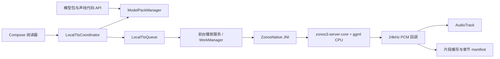

## Context

App 已有章节、原文 revision、UTF-16 锚点、服务器音频产物和听书播放入口。服务器合成适合批量任务，本地合成适合用户点击当前章节后的低延迟试听与连续阅读。ZONOS3 Mini 的 `zonos3-server-core` 已经把模型和采样逻辑放在独立核心库中，`ggml` CPU 后端提供 Android AArch64 支持和 KleidiAI 选项。当前 Android 工程还没有 NDK/JNI 接入，需要先把桌面服务器壳层与可复用推理核心分开。

## Goals

- 首段音频尽快到达播放器，生成与播放可以并行。
- 对章节正文、章节名、标点停顿和 UTF-16 定位使用现有阅读器语义。
- 模型只在需要时下载和加载，能够释放、升级、校验并恢复。
- 通过 AArch64 运行时特性选择、KleidiAI 和基准测试降低 ARM64 推理时间。
- 每个本地片段可独立重试，进程退出或网络中断不会破坏已经发布的缓存。

## First release scope

首版支持 `arm64-v8a`、单设备单模型驻留、单个本地生成队列、24kHz 单声道 PCM 流式输出，以及四个预编码声线代码：`说书人一`、`说书人二`、`林川`、`Haoran`。支持章节名作为独立 cue，正文按现有分句与原文范围生成。用户上传参考音频的本地声线提取、GPU/NPU 后端和多任务并行调度留到后续评估。

## Architecture

### 1. Native build and ARM64 dispatch

使用 Android NDK 构建 `arm64-v8a` 原生库。核心复用 `zonos3-server-core`，移除 HTTP server、桌面命令行和服务器文件扫描路径，只保留模型加载、文本归一化、采样和 PCM 输出。

`ggml` 构建启用 `GGML_CPU_KLEIDIAI=ON` 与 `GGML_CPU_REPACK=ON`。编译产物保持 Android AArch64 基线兼容，运行时根据 CPU 能力选择 dotprod、FP16、i8mm、SVE 或 SVE2 内核。不能把 i8mm 或 SVE 作为所有设备都具备的编译前提。构建产物记录 NDK、编译器、ggml、ZONOS3 和引擎 revision。

加入独立 benchmark 命令，测量模型加载、首段延迟、持续 RTF、线程数、峰值 RSS、温度和不同 `CPU_CHUNK`/线程配置。首版把设备能力分为 baseline、dotprod、fp16、i8mm/SVE 优化档，按实测结果写入运行时配置。

文本归一化依赖需要提供 Android 可链接的静态库。实施阶段优先编译现有 `zyphra-textnorm` Android 版本，若其依赖无法在 NDK 链接，则实现行为等价的受限适配层，并把归一化版本写入缓存身份。

### 2. Model pack and residency

release APK 包含 JNI `.so`、运行时和小型预编码声线代码，不包含模型权重和书籍。首次进入 App 时必须完成模型下载和校验，完成前不进入书架。服务器仍发布带版本号、文件大小、SHA-256、最低剩余空间、引擎 revision 和兼容 ABI 的模型包清单，供备用源和资源更新校验。

首版模型下载包含 `backbone-ptq.gguf` 和 `zac-keep2.gguf`。预编码声线代码放在 APK asset 中。参考音频编码器、SSL teacher 等仅用于服务器生成声线代码的资源不随 App 下发。模型约 1.1GB，最终大小以 manifest 为准。默认源为 `https://hf-mirror.com/Zyphra/ZONOS3-Mini/resolve/main/gguf/`，代码中记录文件大小和 SHA-256，避免把远端响应当作可信校验。

`ModelPackManager` 在用户确认后将下载写入临时目录，支持 HTTP Range、ETag、断点续传、暂停和取消。全部文件校验通过后，以同一文件系统原子改名并写入 ready 状态。用户取消或网络失败不影响书架和服务器合成。版本切换保留当前正在播放的模型引用，旧版本在没有活跃任务且用户允许清理时删除。

进程内最多驻留一套模型。加载失败、哈希不匹配、空间不足或可用内存低于 manifest 阈值时，运行时报告明确状态，不创建半成品章节。模型加载期间 UI 显示准备进度，目录和阅读页面继续可用。

### 3. Kotlin/JNI contract

Kotlin 层提供 `LocalTtsRuntime` 与 `LocalTtsJob`，接口至少包含 `prepare`、`synthesizeSegment`、`cancel`、`release` 和 `status`。JNI 不暴露服务器 HTTP 接口，采用受控的文件描述符、文本和 voice code 参数。

每个 job 固定书籍、章节、原文 revision、segment ID、spoken text、声线代码、模型 revision、引擎 revision、标题 cue 规则和停顿参数。运行时逐段回调 PCM 帧和生成事件，回调线程不直接触碰 Compose 状态。取消使用原子标记，在当前模型调用返回后停止下一段调度。

生成配置与导出/播放配置分开。播放器速度只改变 `AudioTrack` 的播放参数，不改变本地生成缓存。章节名作为独立标题 cue 进入 manifest，标题和正文之间的停顿使用有界参数。空格、逗号和句末停顿由现有 spoken text 与分句规则提供，缓存中保存规则版本。

### 4. Streaming playback and cache

点击“听”时先查找与当前原文 revision、声线、模型和引擎完全匹配的本地片段或服务器产物。已有有效产物直接播放。缺少本地片段且模型 ready 时，本地生成队列按标题和正文句子顺序工作，首个完整片段到达后立即写入 `AudioTrack`，后续句子边生成边追加播放，整章完成后再发布完整缓存。

每个片段先写临时文件，校验采样率、声道、有限值、时长和文件哈希后原子发布。章节 manifest 只有在片段记录 ready 后才可见，包含 `book_id`、`chapter_id`、`source_revision`、UTF-16 范围、标题 cue、片段顺序、voice code、model revision、engine revision、pause rule revision 和 PCM 哈希。播放过程中允许只消费已发布的连续前缀，缺失片段显示生成状态。

已完成片段在任务失败、应用被杀或网络中断后保留。恢复时校验 manifest 与文件，只重排缺失或损坏片段。章节全量完成后可以被现有 `AudioChapter` 播放器复用，不生成假的 complete 标志。

### 5. Scheduling and failure boundaries

本地生成队列同一时刻只运行一个模型 job。`LocalTtsSynthesisWorker` 使用 WorkManager 的前台执行模式和媒体播放通知，负责当前章节的低延迟生成。每个已完成句子先写入片段缓存，再继续下一句。系统低内存、低空间、音频焦点丢失和用户取消都可以暂停后续片段，进程退出后 WorkManager 重新调度并复用已发布片段。

失败按模型准备、文本归一化、推理、PCM 校验、文件发布和播放器六类记录。可重试错误只重试当前片段并限制次数。重复提交同一章节配置复用有效片段，强制重做创建新的 local generation ID。原文 revision、声线、模型或引擎变化生成新的缓存身份。

设备不支持 `arm64-v8a`、模型无法准备或本地 RTF 超出运行时门槛时，UI 展示原因并提供服务器合成入口。服务器合成产物仍沿用现有 artifact identity 和 Range 播放协议，不能被本地半成品覆盖。

### 6. Performance acceptance

首版在至少一台 8GB RAM 的 Android ARM64 设备和一台低内存设备上建立基准。目标值作为优化门槛写入验收记录：模型已 ready 的暖启动首个 PCM 不超过 3 秒，正常中文片段暖态 RTF 不高于 1.0，冷启动加载不超过 15 秒。若设备达不到门槛，运行时进入远程合成提示或降低并发与预取策略。

基准必须记录设备型号、Android 版本、SoC、CPU 特性、线程配置、模型 revision、声线、片段长度、首段延迟、持续 RTF、峰值 RSS、温度和失败率。优化以可复现实测为准，不能用桌面 M3 或服务器数据替代 Android 设备结果。

## Risks and trade-offs

- 约 1.1GB 模型会增加首次准备时间和存储占用，模型包采用断点续传和按需准备，清理策略交给用户确认。
- 手机 CPU 的持续性能受温度和功耗影响，运行时需要监测 RTF 与系统状态，长时间任务允许暂停或转服务器。
- Android 进程可能在后台被回收，本地片段原子发布和可恢复队列用于保留已完成进度。
- 文本归一化若与服务器版本不同会造成缓存分叉，归一化版本进入缓存身份并在模型包 manifest 中声明。
- 预编码声线覆盖范围有限，用户上传声线提取继续通过服务器完成，后续再评估端侧 encoder。

## Rollout

1. 先完成 Android ARM64 benchmark、JNI smoke test 和模型包校验，不改变默认听书入口。
2. 启用模型准备页和本地单段试听，验证首段播放、取消、进程重启和缓存恢复。
3. 启用章节连续生成和后台续作，接入现有 `AudioChapter` 与阅读定位。
4. 在目标设备上完成温度、低空间、低内存、断网和坏文件演练后，再把本地路径作为缺失音频的默认选项。
