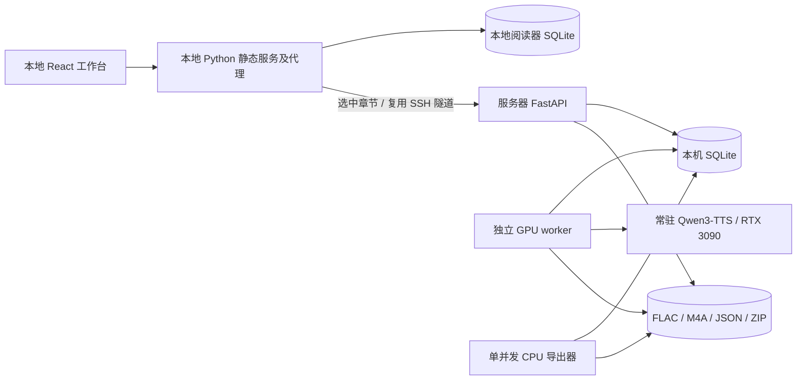

## Context

项目已有 Kotlin/Compose 阅读器、SQLite 书库、Python 分句与合成脚本，以及逐段 FLAC、章节 M4A、JSON cue 的导出流程。目前 GPU 脚本按命令启动并加载模型，配置哈希混合了声音生成与成品倍速；单段输出异常可能使同批有效音频一并失败。这些行为需要在服务化时调整。

2026-11-11，服务器旧合成任务已停止，小说数据库、音频、试听、日志与临时文件已清理。`/h/work/shanye-tts-emengshitu-20261109` 仍保留模型、CUDA/Python 环境、依赖缓存和脚本。服务已按 apply 指令部署；从空服务库初始化。本地书库由本地启动器只读访问，只有显式提交的章节进入服务器任务快照，不创建旧长篇任务的自动续跑计划。

首版面向单用户、局域网内一台 RTX 3090 服务器。本地浏览器通过持久 SSH 隧道访问；浏览器页面关闭不影响已受理任务。规范入口为 [proposal.md](proposal.md)，行为验收由 [specs](specs/) 定义。

## Goals / Non-Goals

**Goals:**

- 用本地工作台完成目录选择、音色设置、试听、批量合成、任务控制、同步播放和下载。
- 长任务持久化，模型常驻，单 GPU 独占；失败恢复复用已校验片段。
- 保持阅读器的规范原文与 UTF-16 锚点，产物能够回到对应章节、句子和文本版本。
- 分开语音生成与 CPU 导出，保存不可变的预设、片段和成品版本。
- 在清理后的服务器上安全初始化，并复用已验证的模型和环境。

**Non-Goals:**

- 首版不做浏览器 TXT/EPUB 上传、爬书、账号系统、公网服务、多租户或云存储。
- 不做 IndexTTS2/VoiceDesign 接入、多角色自动配音、多 GPU 或逐字强制对齐；克隆音色与近似节奏由 Qwen3-TTS Base 参考音频提示实现，不承诺逐字复制韵律。
- 不接入 Android 播放，也不自动上传本地小说、同步本地下载目录或恢复已删除内容。
- 不保证模型指令一定产生指定情绪，也不承诺随机生成逐字节可重现。

## Decisions

### 1. API、常驻 worker 与本地代理分离



Web 采用 React + TypeScript + Vite；API 使用 FastAPI/Pydantic/Uvicorn，负责校验、查询和事务，不加载模型。GPU worker 沿用现有 PyTorch/CUDA 环境，只在启动或故障恢复时加载 Qwen3-TTS CustomVoice；API 使用单独环境，避免 Web 依赖安装改变 Torch。CPU 导出并发默认 1，与 GPU 推理独立调度。

从 `tts/` 提取 catalogue、engine、validation、exporter 模块，CLI 和服务调用共同实现。服务任务控制替代进程级 `STOP_REQUESTED` 的任务含义，worker 退出与某一任务暂停分别处理。

选择 SQLite 持久队列是因为当前只有一台主机和一个 GPU。FastAPI 请求内直接推理会阻塞 API 且难以恢复；Redis/Celery 会增加首版运维成本，留待多机调度需要时评估。

### 2. 本地只读书库，服务器接收选中章节

初始化只创建服务 schema、默认预设和运行配置，不扫描服务器磁盘找书或读取旧计划。Web 的目录、检索、范围解析及原文接口由本地代理直接读取 `--library` 指定的阅读器 SQLite；默认 `app/src/main/assets/shanye.db`，不会把整个数据库发送到服务器。只读连接保持来源不变。

本地代理在任务/试听提交时补入 `inline_chapters`：稳定书籍/章节 ID、规范原文、版本哈希与 UTF-16 锚点。服务器验证原文哈希并重新分句、转换 spoken_text，仅保存被选中的任务输入。预估在临时内存数据库中计算，不能修改正式目录。浏览器目录始终以本地书库为准；历史产物的旧 revision 可回源服务器读取。管理员显式 SQLite/历史音频导入仅用于测试或迁移，普通用户无需上传整本书。

`book_id` 为书籍身份，`chapter_id` 保持来源身份映射，跨书籍唯一；`chapter_index` 只表示原书物理顺序，`chapter_number` 只是展示/检索字段。章节内容另存 `source_revision` 与规范文本哈希。重复导入相同来源不重复建章；内容更新生成新 revision，保留旧版本所依赖的文本和产物。缺少可靠来源 ID 时分配服务 ID 并持久保存导入映射，不按展示章号生成身份。

范围输入先经本地目录解析成明确 `chapter_ids`，前端不计算“章号减一”。区间包含所有落在范围内的源章节并按物理顺序排序；单章出现多个同号条目时返回候选，要求明确选择。不存在的章号、非法区间、其他书的 ID 均在创建任务前报错，不悄悄忽略。

### 3. 原文锚点与朗读输入分开存储

章节保存与 Android `Chapter.text` 一致的规范原文。父句按中文终止标点分割，长句再拆为有界语音片段；片段保留父句 ID、父句及自身的 UTF-16 半开区间 `[start, end)`。空白跳过规则、分句和规范化版本均进入元数据。

`original_text` 能按区间从对应原文版本取回；`spoken_text` 用于简体朗读等转换。简繁显示转换不能写回规范原文或改变锚点。异常片段二次拆分时保存父子关系和新的准确范围，不能漏读、重复覆盖非空白文本或切开代理对。后续读音词典只改变朗读输入及缓存版本。

### 4. 声音配置不可变，生成与导出各自寻址

默认预设 `narrator-uncle-fu-v1`：福叔（Uncle_Fu），采用 `server/voices.py` 的克制讲述指令，成品速度 `1.0`，句间停顿 `180ms`。能力接口返回实际支持的 speaker、中文说明、原生语言及对应的内置预设 ID，完整模型提供 9 种独立嗓音。初始化按稳定 ID 补充内置预设，不覆盖旧 `bright-neutral-dylan-v1`、自定义/克隆预设及历史任务快照。内置预设与用户保存预设在页面分组展示。首版校验成品速度 `0.75–1.5`、整数停顿 `0–2000ms`。预设名称可读，版本记录不可变；任务提交时快照引用版本及导出设置。编辑预设创建新版本，运行任务继续使用原快照。

模型能力接口返回固定音色及 Base 克隆模型就绪状态。参考音频通过 multipart 同源上传，限制 50MiB、1–30 秒；FFmpeg 解码为 24kHz 单声道 PCM WAV，保存哈希和逐字稿。ICL 模式使用参考音频与逐字稿；x-vector 模式仅提取音色，节奏模仿较弱。生成快照包含参考音频 ID/哈希、Base revision、逐字稿及模式。worker 切换模型种类时释放旧模型，复用相同参考提示。语气指令仅供 CustomVoice；克隆预设隐藏固定音色和语气编辑。

| 对象 | 身份 / 缓存依据 | 变化后行为 |
| --- | --- | --- |
| 生成变体 | 原文 revision/hash、片段范围与文本、spoken_text、规范化/分句版本、引擎、模型 revision、speaker、完整指令、有效生成参数 | 只复用完全匹配且文件校验通过的片段 |
| 生成实例 | 变体、segment_id、generation_id；记录 seed、批次、运行库及尝试次数 | 强制重做使用新的 generation_id，旧实例保留 |
| 章节导出 | 按顺序列出的片段实例 ID/音频哈希、speed、pause_ms、编码器配置与时间索引版本 | 仅速度、停顿、编码变化时走 CPU 导出 |
| 播放器速度 | 浏览器当前播放设置 | 不修改服务配置，不创建任务或产物 |

执行批大小、运行库与实际随机种子保留为执行溯源；有效采样参数进入生成配置。批次重组可能影响随机结果，缓存表示可接受的已生成版本，并非逐字节重现承诺。默认 reuse 模式可复用相同配置的试听片段；new-version 为指定范围分配新生成实例，发布新成品，不覆盖旧文件。

### 5. 持久队列、独占锁和明确的任务控制

任务拆为 job → chapter item → segment attempt，另有 CPU export/bundle item。状态统一为：

```text
queued → running → exporting → succeeded
            │          │
            ├──────────┴→ partial_failed / failed
            ↓
         pausing → paused → queued

queued / running / exporting / pausing / paused → cancelling → cancelled
```

queued 可直接进入 paused/cancelled；exporting 也接受暂停，在当前导出单元结束后进入 paused。`partial_failed` 表示仍有可用结果但选定范围未全部成功；`failed` 表示不可恢复的任务级错误。终态不原地改写：retry-failed 创建关联的新任务，快照原配置，只调度失败/缺失项并复用有效结果。

领取工作用短事务记录 owner、lease、heartbeat、attempt token；GPU/FFmpeg 不占用数据库事务。工作期间独立续约，提交结果时校验 token，防止过期持有者发布。恢复仅处理服务中已存在且控制状态允许的任务，保留 paused/cancelled 语义。API 重启不影响 worker；worker 重启验证已提交文件后再补缺失内容。

GPU 锁放在服务器本机 Linux 文件系统，所有服务 worker 与兼容 CLI 共用。第二个执行器无法获得锁时显示外部占用，不同时加载/推理。试听与普通任务共用 worker，当前批次完成后选择试听；同优先级 FIFO，默认连续处理最多 3 个试听后，若普通队列非空就执行一个普通批次。不会为试听中断正在运行的 CUDA 调用。

创建试听、合成及下载包要求幂等键，事务内绑定规范请求哈希与返回 ID。同键同请求返回原记录，同键不同请求返回 409；浏览器断线后用原键核对，不自动使用新键重交。

暂停/取消记录期望状态，运行中先显示 pausing/cancelling，在当前 GPU 批次或 CPU 导出单元校验落盘后停止后续调度。取消保留已提交缓存。恢复需显式 resume；重复同一控制操作返回当前状态，非法终态操作报告冲突。空间不足触发带原因的暂停，不删除产物腾空间。

### 6. 每段独立提交，失败重试有界

一个批次返回后逐段做采样率、非有限值、时长、音量和文件校验，有效段立即独立提交。默认每个语音单元首次生成后最多重试 2 次；错误分类及次数对用户可见。OOM/批级错误先缩小批次至单段；持续异常的单段最多再拆分一层，子段各适用有限重试，避免无限递归。不可再拆或耗尽预算后标为失败。

保留当前 0.2–120 秒校验基线并为实际极短标点段提供显式策略，不能仅放宽上限接受异常长输出。音量阈值沿用已验证逻辑并版本化。失败片段展示原文、所在章节、尝试次数与错误；其他有效章节可发布。任何缺段章节都不能以完整章节发布；试听则使用单独的范围产物与 `complete=false`。

### 7. 元数据与大文件分开，按不可变版本原子发布

SQLite 服务库放在本机 Linux 文件系统，如 `/home/koth/.local/share/shanye-tts/`，启用外键、短事务、busy timeout、WAL/checkpoint，并使用 SQLite backup API 备份。`/h` 的既有 `fuseblk` 挂载用于模型和大文件，实施时验证同目录替换、flush 与故障恢复能力；不能满足要求时选择合适的持久文件系统后再部署。

数据表分为：目录与 source revisions、sentences/segments、voice preset versions、synthesis variants/segment audio、jobs/items/attempts/events、chapter exports/artifacts、download bundles。`reading_profiles` 可用于保存用户显式确认的章节与版本选择，默认空，不读取旧计划自动重建。

音频先写目标文件系统内临时文件，flush 并校验哈希后原子改名，最后事务发布 ready 记录。章节导出由冻结的有序片段清单驱动，M4A、JSON 都验证后一次发布 artifact_id。崩溃留下的未发布文件由恢复流程对账，不作为缓存命中。已发布文件损坏或丢失后标记不可用并重新生成缺失依赖，不报告成功。

时间索引基于各片段倍速处理后的实际 PCM 样本数累加，停顿加入时间轴；保留现有 cue 字段，新增版本、原文哈希和依赖信息。cue 是片段边界而非逐字对齐；浏览器按父句合并高亮，点句子跳到该句首个 cue，停顿区间不错误高亮下一句。实测编码时长需在声明的容差内与 PCM 时间轴一致。

产物路径使用 `book_id/variant_id/chapter_id/export_id`；可读下载名中的章号不承担唯一性，重名时追加身份后缀。M4A、JSON 始终属于同一 export，旧 URL 在保存期内返回旧版本。

### 8. 本地一键启动、复用 SSH 与端到端文件传输

远端 API 监听 `127.0.0.1:17860`；本地隧道也绑定 loopback `17860`，静态服务及同源代理默认 `127.0.0.1:17861`。冲突时报告或显式选择其他本地端口，不终止不属于本启动器的进程。一个启动器维护一条 SSH 转发并复用已可验证的连接，配置保活及有界退避重连；SSH 凭据仅由本地进程/OpenSSH 持有。

本地服务校验 Host/Origin，写请求要求本地会话凭据及 JSON/multipart 内容类型，拒绝外站驱动本机任务。API 使用由代理注入的服务凭据；浏览器不持有 SSH 密钥或长期服务凭据。此方案以 SSH 授权的单用户为边界，公网部署需要独立设计。

前台每 2 秒读取任务快照与增量事件，后台降低频率；刷新从服务恢复状态。连接断开只改变连接状态，不把任务改成失败或成功。UI 展示目录、物理同号顺序、可复用/缺失数、声音/导出快照、当前阶段、失败原文与估计值来源；没有实测历史时不编造 ETA。

文件 API 仅接受 artifact_id。API 和代理端到端保留 Range、206/416、Content-Range、Accept-Ranges、Content-Length、ETag；流式传输，不将整章载入内存。批量 ZIP 是持久 CPU 任务，包含 M4A、配套 JSON、目录及各文件哈希；只打包选定可用版本，缺失项报错并返回清单。临时包 TTL 可清理，已确认音频不自动删除。

本地保存使用浏览器下载，由用户选择位置；界面可显示服务器就绪或请求已发起，不能据此宣称已写入某个本地目录。音频盘和元数据盘均监控容量，可写目录任一低于 5GiB 时停止领取新生成/导出单元，完成当前单元检查点后暂停，显示原因，释放空间后显式继续。

### 9. API 边界

所有接口置于 `/api/v1`，OpenAPI 固定错误结构和枚举，创建类操作返回任务 ID；HTTP 受理成功不等于合成完成。

| 接口 | 语义 |
| --- | --- |
| `GET /health` | API/worker/model/GPU、磁盘、可接收任务状态，不把空书库作为故障 |
| `GET /books`、`GET /books/{id}/chapters` | 本地只读书库、分页目录与标题检索 |
| `POST /chapter-selections/resolve` | 输入 book_id 和范围或 ID，返回明确选择/歧义/错误 |
| `GET /voices`、`GET/POST /presets` | 模型能力、预设列表与创建不可变版本 |
| `POST /voice-clones` | 上传参考音频、逐字稿及模式，创建克隆预设 |
| `POST /previews`、`POST /jobs` | 固定配置快照与幂等创建；试听范围由完整片段组成 |
| `POST /jobs/estimate` | 可复用/缺失片段、空间及基于近期实测的时间区间 |
| `GET /jobs`、`GET /jobs/{id}` | 持久状态、分页任务/事件、错误和产物引用 |
| `POST /jobs/{id}/actions` | pause/resume/cancel/retry-failed，返回状态或新关联任务 ID |
| `GET /artifacts/{id}/audio`、`.../manifest` | 同一不可变版本的媒体与文本时间索引 |
| `POST /download-bundles`、`GET /download-bundles/{id}`、`.../file` | 创建、查询、下载批量包 |

## Risks / Trade-offs

- [模型可能忽略中性指令或读错人名] → 先试听，保留版本并支持指定失败/问题范围新建版本；ASR 复核留待后续。
- [常驻模型占用 GPU 显存] → 独占锁、健康状态和显式进程维护；不让多个任务进程分别加载模型。
- [长批次增加试听和暂停等待] → 展示批次边界语义，按显存及实测延迟设置批量大小，不承诺固定试听秒级延迟。
- [文件与 SQLite 无跨介质事务] → 文件先校验、记录后发布、不可变路径、启动对账和一致备份。
- [FUSE 挂载与系统盘容量限制] → 部署前验证文件语义，元数据留在本机 Linux 文件系统，大临时文件置于音频盘；双盘容量检查。
- [UTF-16 与 Python 字符索引差异] → 明确转换边界，使用含代理对、换行、缩进、繁体和长句拆分的往返用例。
- [SSH 断线造成提交状态未知] → 持久幂等键、重连读取快照，不用新的提交请求猜测结果。

## Migration Plan

1. 实施前检查保留环境、模型 revision、目录、可用空间和用户 systemd/linger 能力，建立独立服务目录与环境；不调整保留的 CUDA 依赖。
2. 创建空服务库和默认预设，先验证空库启动、健康检查、本地代理及 SSH。安装服务不导入小说、不创建合成任务。
3. 本地启动器加载选定的阅读器 SQLite；目录浏览不上传内容，正式提交才发送选中章节。使用独立测试书和独立服务库验收，不重建已删除服务器书库。
4. 历史产物导入属于可选显式命令：要求书籍/原文/配置映射与文件校验。只有匹配 FLAC 及完整生成元数据的片段可成为生成缓存；仅 M4A+JSON 可登记为导出产物，不能假定存在原始片段或伪造可复用状态。不接受以迁移名义自动生成缺失结果。
5. 先部署 API/只读查询，再启用 worker；CLI 和服务统一 GPU 锁。进行短任务与恢复验收后，用户再选择批量任务。
6. 回退时停止接单，当前批次保存检查点后停止 worker，备份新服务库，保留所有模型、环境、产物及配置。旧 CLI 仅经显式启动使用兼容模块，不自动续跑、不删除新数据。

## Open Questions

- 部署时确认服务目录、模型 revision、systemd 用户服务可用性及 `/h` 文件替换语义，结果写入部署配置；这些不阻塞提案审阅。
- 批量大小、吞吐预估和极短片段音量阈值通过实施阶段短基准确定，采用保守默认值并展示测量来源。
- 克隆参考 M4A 与逐字稿由用户选择，先试听再决定批量任务。不同目标文本的停顿和重音以试听为准。
